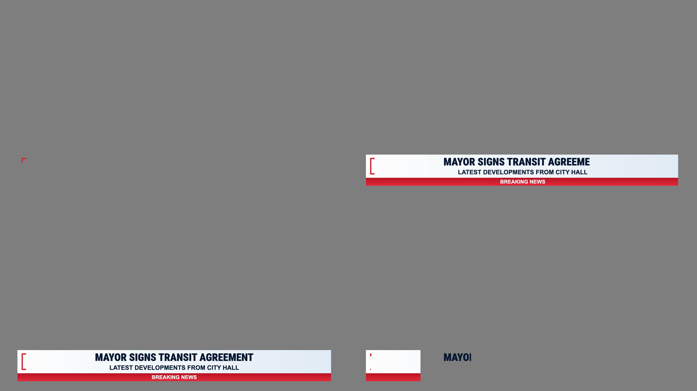

# OGraf → Flame

Render [OGraf Studio](https://github.com/zerodensity/ograf-studio) broadcast graphics straight into
Autodesk Flame as clips with alpha.

Right-click a reel in Flame, pick a template, type your text, and the graphic is rendered frame by frame in
headless Chrome and imported as a transparent PNG sequence.



> **Status: experimental.** Tested on Flame 2026.2.2 on macOS. Linux should work but is untested. This is a
> community project, not affiliated with Autodesk, Zero Density or the EBU.

## What it does

- Adds **OGraf › Render OGraf Graphic…** to the Media Panel right-click menu (on a reel, library or folder) and to
  the Flame main menu.
- Reads the template's fields (text, colours, numbers, options) and shows them as a form.
- Renders **Play → hold → Stop** through the OGraf non-real-time API (`setActionsSchedule` + `goToTime`), so every
  frame is exact and repeatable, not a screen recording.
- Writes RGBA PNGs to `~/Movies/OGraf Renders/<name>_<timestamp>/` with a `fields.json` of the values used, then
  imports the clip into the reel you clicked.

It is an offline render step, not a live Batch node: change a field and render again.

## Requirements

- Autodesk Flame 2026 (Python 3.11 / PySide6)
- [Node.js](https://nodejs.org) 22 or newer
- Google Chrome (or Chromium / Edge)
- Optional: an [OGraf Studio](https://github.com/zerodensity/ograf-studio) checkout, to open `.ogs` template
  sets directly

## Install

```sh
git clone https://github.com/mert5961/ograf-flame.git
cd ograf-flame
./install.sh
```

To also open `.ogs` template sets without exporting them first, point the installer at an OGraf Studio checkout
(it runs `npm ci` and builds the runtime there if needed):

```sh
git clone https://github.com/zerodensity/ograf-studio.git ~/ograf-studio
./install.sh --studio ~/ograf-studio
```

Then in Flame: **Flame menu › Python › Rescan Python Hooks**, or restart Flame.

The installer links this folder into `/opt/Autodesk/shared/python/ograf_flame`, so `git pull` updates the hook.
Use `--hooks-dir` for another hooks folder. Remove it with `./uninstall.sh`.

## Use

1. In OGraf Studio, export your template with the **Non-real-time** or **Dual** profile (`.ograf.zip`), or skip
   this and pick the `.ogs` file if you installed with `--studio`.
2. In Flame, right-click a reel › **OGraf › Render OGraf Graphic…**
3. Choose the file, the template (for a set), edit the fields, set **Hold after Play**, frame rate and start frame.
4. **Render & Import**.

To try it without making a template, use the examples in OGraf Studio, e.g.
`ograf-studio/examples/signal-blue.ogs` (lower thirds, straps, ticker).

## Command line

The renderer works without Flame:

```sh
node renderFrames.mjs --input lower-third.ograf.zip --describe          # list fields as JSON
node renderFrames.mjs --input lower-third.ograf.zip --out ./frames \
  --data '{"headline":"HELLO FLAME"}' --hold 4 --fps 25 --start-frame 1001
```

Options: `--template`, `--data <json|@file>`, `--fps`, `--width`, `--height`, `--hold`, `--no-stop`,
`--start-frame`, `--name`, `--chrome`, `--studio`.

## Settings

| Environment variable  | Purpose                                 |
| --------------------- | --------------------------------------- |
| `OGRAF_NODE`          | Node.js binary to use                   |
| `OGRAF_CHROME`        | Chrome / Chromium binary                |
| `OGRAF_STUDIO_DIR`    | OGraf Studio checkout for `.ogs` input  |
| `OGRAF_FLAME_OUTPUT`  | Where renders are written               |

## Limits

- About 7–10 frames per second at 1920×1080: a 5-second lower third takes about 15 seconds.
- Graphics that use live inputs (webcam, named live sources) cannot render offline.
- Real-time-only packages are rejected; re-export with the Non-real-time or Dual profile.
- `.ogs` input builds the package without OGraf Studio's browser certification checks. Export from Studio when you
  need a certified package.

## Files

| File               | Role                                                                          |
| ------------------ | ----------------------------------------------------------------------------- |
| `ograf_flame.py`   | Flame hook: menu entries, field form, runs the renderer, imports the clip    |
| `renderFrames.mjs` | Headless-Chrome frame renderer (no npm dependencies)                          |
| `exportPackage.mts` | Builds a non-real-time package from a `.ogs` set using an OGraf Studio checkout |
| `install.sh`       | Checks requirements and links the hook into Flame                             |

## License

[AGPL-3.0](LICENSE), the same as OGraf Studio.
